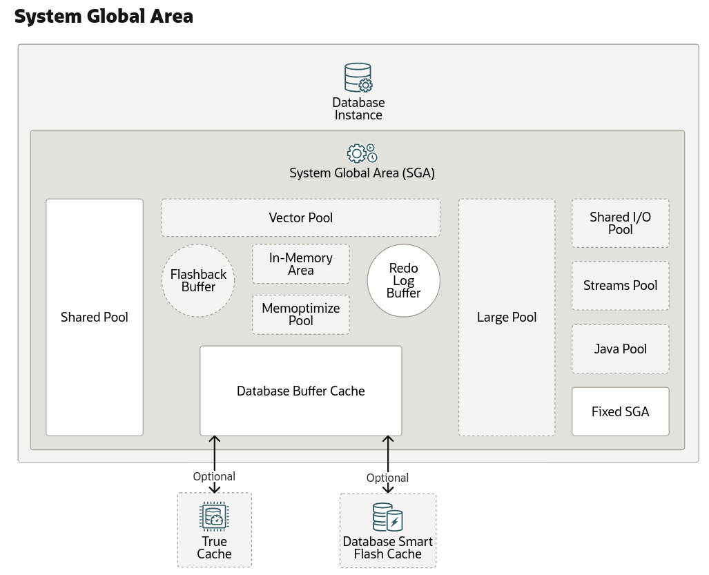
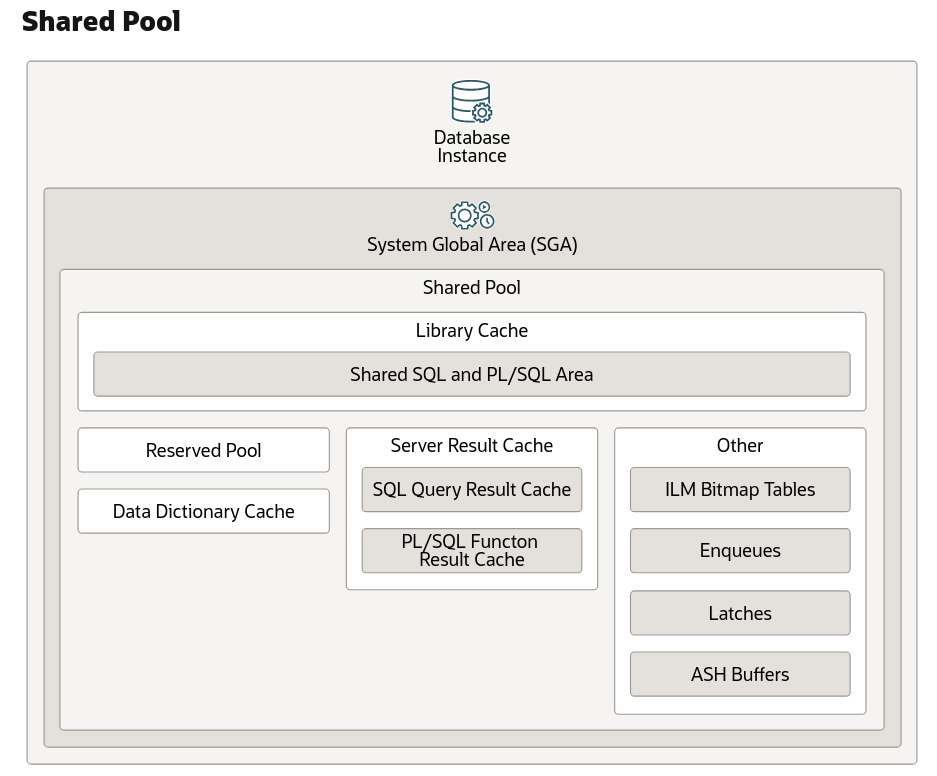
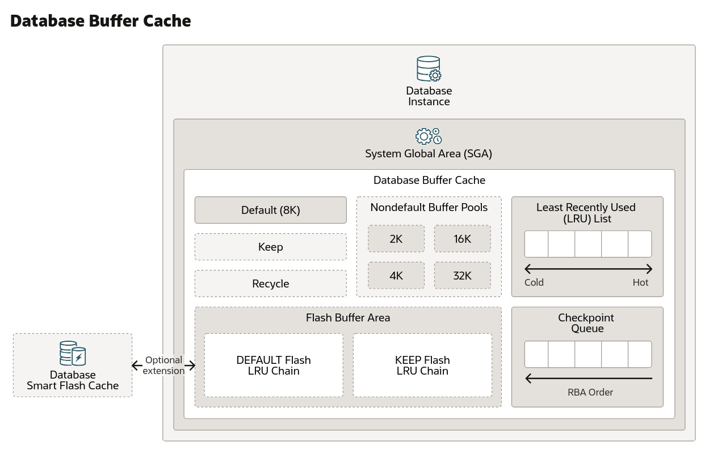

# Oracle : SGA vs PGA

Notes de présentation sur la mémoire de la base de données Oracle, avec focus sur les composants du **SGA (System Global Area)** et le rôle de la mémoire dans les performances.

## Vue d'ensemble du SGA

Le **SGA (System Global Area)** est une région de mémoire partagée au sein de l'instance de la base de données Oracle. Elle regroupe plusieurs composants clés : le **Shared Pool**, le **Database Buffer Cache**, le **Redo Log Buffer**, et d'autres (Large Pool, Java Pool, Streams Pool…).



---

## I. Shared Pool

Le **shared pool** est un composant du SGA responsable du caching de différents types de données de programme. Il stocke notamment : le parsed **SQL**, **PL/SQL**, les paramètres système et les informations du **data dictionary**.

Presque toutes les opérations de la base de données impliquent le shared pool. Par exemple, lorsqu'un utilisateur exécute une instruction SQL, Oracle accède au shared pool.



### Library Cache (Shared SQL and PL/SQL Area)

La **library cache** est une structure mémoire du shared pool qui stocke le code SQL et PL/SQL exécutable. Elle contient les zones *shared SQL* et *PL/SQL*, ainsi que des structures de contrôle comme les **locks** et les **handles** de library cache.

Lorsqu'une instruction SQL est exécutée, le texte de la requête est analysé syntaxiquement et sémantiquement. Oracle vérifie si un plan d'exécution identique existe déjà en mémoire (évitant un **Hard Parse**) ou en génère un nouveau. Lorsqu'une instruction SQL est exécutée, la base de données tente de réutiliser du code précédemment exécuté :

| Situation | Résultat |
|---|---|
| Une représentation analysée existe dans la library cache et peut être partagée | **soft parse** (library cache **hit**) — le code est réutilisé |
| Aucune représentation réutilisable n'existe | **hard parse** (library cache **miss**) — une nouvelle version exécutable doit être construite |

### Data Dictionary Cache

Le **data dictionary cache** stocke les définitions des objets de la base (tables, index, vues, colonnes…). Lors de l'analyse d'une requête, le moteur consulte ce cache pour valider les métadonnées des objets ciblés (existence de la table, structures des colonnes, validation des contraintes d'intégrité et des privilèges de l'utilisateur) sans recourir à des lectures physiques sur disque.

### Requêtes utiles

**1. Voir la répartition détaillée de la mémoire dans le Shared Pool**

```sql
SELECT *
FROM v$sgastat
WHERE pool = 'shared pool'
ORDER BY bytes DESC;
```

**2. Vérifier l'efficacité du Library Cache (Hit Ratio)**

```sql
SELECT namespace, ROUND(gethitratio * 100, 2) AS hit_ratio
FROM v$librarycache;
```

---

## II. Database Buffer Cache

Le **Database Buffer Cache** est la région de la RAM responsable de la conservation de copies des **data blocks** lus depuis les *datafiles* physiques sur disque.



### Pourquoi est-ce essentiel ?

Le **disk I/O** est historiquement le plus gros *bottleneck* de performance dans tout système de base de données. Le buffer cache vise à maximiser le **cache hit ratio** :

- **cache hit** : les données demandées y sont présentes.
- **cache miss** : les données demandées n'y sont pas présentes.

### Dirty Blocks

Les **dirty blocks** (blocs présents en mémoire principale mais pas encore à jour sur le disque) ne sont pas automatiquement écrits par le SGA : celui-ci met à jour le buffer mémoire et journalise les modifications, puis le processus **DBWn** vide de manière asynchrone ces dirty blocks du buffer cache vers les *datafiles* sur disque.

### Mécanisme de gestion interne

Deux composants principaux :

- **LRU (Least Recently Used)** : divise les blocs en régions *hot* / *cold* (données fréquemment accédées / données obsolètes ciblées pour l'éviction quand de l'espace est requis).
- **Checkpoint Queue** : une liste ordonnée chronologiquement qui suit tous les dirty blocks, par leur *Redo Byte Address* (**RBA**), guidant DBWn sur quels data blocks modifiés écrire en premier sur disque.

### Requêtes utiles

```sql
SHOW PARAMETER sga_target;
```

```sql
SELECT name, block_size, current_size FROM v$buffer_pool;
```

> **Note** : on ne peut pas modifier la taille de bloc par défaut d'une base de données existante.
> Solution : créer un pool secondaire spécifiquement pour une autre taille de bloc, par exemple :
>
> ```sql
> ALTER SYSTEM SET db_16k_cache_size = 50M SCOPE = both|spfile|memory;
> ```

---

## III. Redo Log Buffer

Le **Redo Log Buffer** est une zone de mémoire **circulaire** (lorsque le pointeur d'écriture atteint la limite physique, il reboucle au début) située dans le SGA. Il consigne de manière séquentielle toutes les modifications (**Data Manipulation Language**, **Data Definition Language**) apportées, avant même qu'elles ne soient écrites dans les fichiers de données principaux.

```sql
SHOW PARAMETER log_buffer;
```

---

## IV. Everything together : le flux complet (Write-Ahead Logging)

### Définitions préalables

- **LGWR (Log Writer)** : processus d'arrière-plan du moteur Oracle dont la fonction exclusive est de lire en continu le contenu du **Redo Log Buffer** en mémoire vive pour l'écrire de manière persistante sur le stockage.
- **Fichiers de redo physiques (Physical Redo Log Files)** : fichiers binaires stockés sur le disque (stockage non volatil) qui conservent de façon permanente et séquentielle l'historique complet de toutes les modifications (*redo entries*) générées par les transactions.

### La séquence technique

**1. Modification en mémoire et indexation**

Lorsqu'une transaction modifie des données, le bloc cible dans le **Database Buffer Cache** est mis à jour (il devient un *dirty block*). Simultanément, un enregistrement de cette modification est inscrit séquentiellement dans le **Redo Log Buffer**, et ce dirty block est positionné dans la **Checkpoint Queue** de manière strictement chronologique selon son *Redo Byte Address* (**RBA**).

**2. Écriture par LGWR sur les fichiers physiques**

Le processus **LGWR** vide le contenu du Redo Log Buffer de la mémoire vers les *fichiers de redo physiques* sur le disque.

**3. Autorisation d'écriture des blocs de données (DBWn)**

C'est la règle fondamentale du **Write-Ahead Logging** : le processus **DBWn** n'a pas le droit d'écrire un dirty block du Database Buffer Cache vers les *datafiles* tant que le journal de redo correspondant n'a pas été entièrement sécurisé sur disque par LGWR à l'étape précédente.

**4. Pilotage par la Checkpoint Queue**

Lorsque DBWn procède à l'écriture des blocs vers les disques, il parcourt la **Checkpoint Queue** du plus ancien au plus récent (selon le RBA). Cela permet à Oracle de savoir précisément quels dirty blocks doivent être purgés en priorité pour que l'espace des fichiers de redo physiques puisse être recyclé en toute sécurité.

**5. Garantie de l'intégrité transactionnelle**

Si le système s'arrête brutalement, Oracle utilise les fichiers de redo physiques et la Checkpoint Queue pour exécuter la **récupération après crash** (*Crash Recovery*), en rejouant les modifications validées ou en annulant les transactions incomplètes.

---
