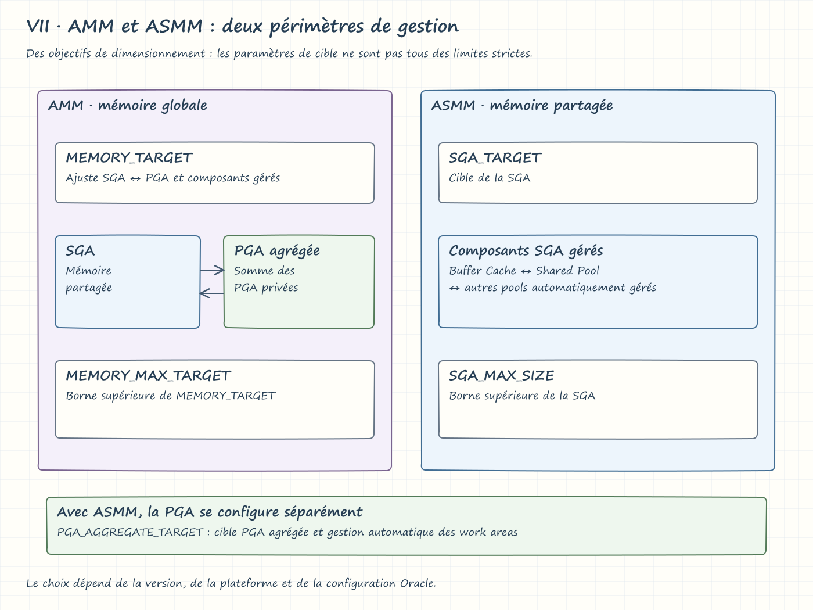
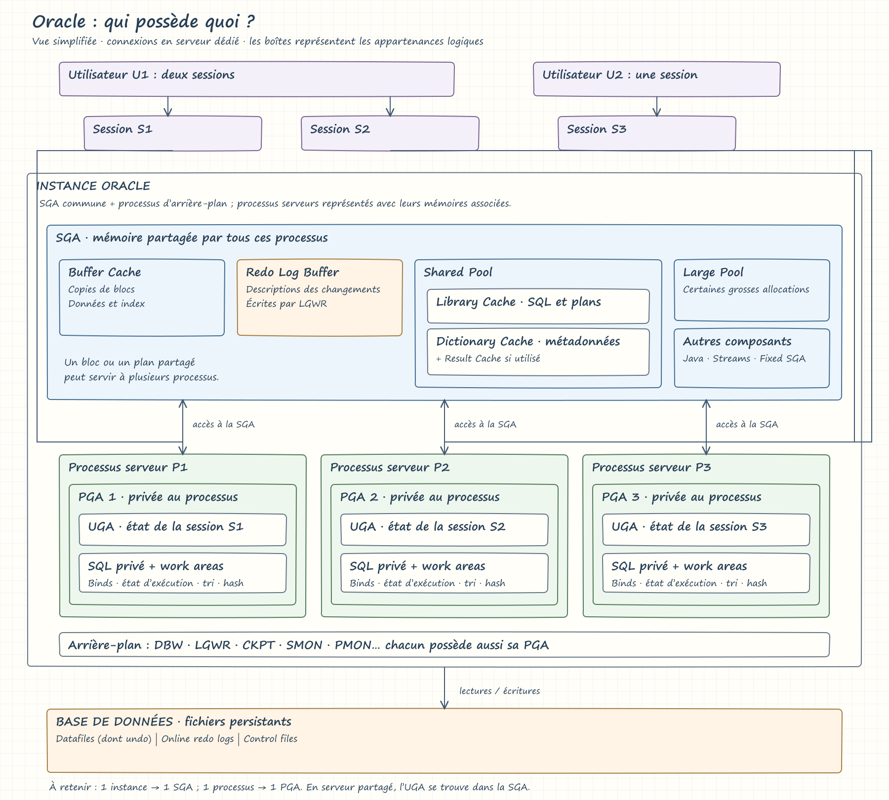

# Oracle : SGA vs PGA

Notes de présentation sur l’architecture d’une base Oracle, la mémoire de l’instance et son rôle dans les performances.

## Architecture : instance et base de données

Une **instance Oracle** est l’environnement d’exécution qui permet de gérer et d’accéder à une base de données. Elle comprend la **SGA** et les **processus d’arrière-plan**. Les processus serveur utilisent également une mémoire privée : la **PGA**.

La base de données correspond aux fichiers persistants : **datafiles**, **control files** et **online redo log files**. Dans une architecture multitenant, la **CDB** est la base conteneur.

| Notion | Définition |
|---|---|
| Instance | Structures mémoire et processus Oracle en cours d’exécution |
| Session | Connexion logique d’un utilisateur à Oracle |
| Processus serveur | Exécute les appels et les instructions SQL pour les sessions |
| Processus d’arrière-plan | Assure notamment l’écriture des blocs et du redo, ainsi que les checkpoints |

### Étapes de démarrage

| État | Opérations et disponibilité |
|---|---|
| Arrêt : SHUTDOWN | L’instance est arrêtée et la base est fermée |
| NOMOUNT | Lecture des paramètres, allocation de la SGA et démarrage des processus d’arrière-plan ; les control files ne sont pas encore ouverts |
| MOUNT | Ouverture des control files et identification des datafiles et des online redo log files ; la base n’est pas encore ouverte aux utilisateurs |
| OPEN | Ouverture des datafiles et des online redo log files ; la base devient accessible selon son mode d’ouverture |

## Vue d’ensemble : SGA et PGA

| Critère | SGA : System Global Area | PGA : Program Global Area |
|---|---|---|
| Portée | Mémoire partagée de l’instance | Mémoire privée d’un processus Oracle |
| Rôle | Partager les blocs de données, le code SQL/PLSQL et les informations nécessaires à l’instance | Conserver l’état privé du processus et les zones de travail SQL |
| Composants principaux | Shared Pool, Database Buffer Cache, Redo Log Buffer, Large Pool, Java Pool, Streams Pool selon la version, Fixed SGA | SQL Private Area, SQL Work Areas et autres allocations privées |


## I. Shared Pool

Le **Shared Pool** est un composant du SGA qui met en cache le code **SQL** et **PL/SQL** analysé, les métadonnées du **data dictionary** et différentes structures de contrôle. Presque toutes les opérations de la base impliquent le Shared Pool : lorsqu’un utilisateur exécute une instruction SQL, Oracle y recherche notamment une représentation réutilisable.


### Library Cache : Shared SQL and PL/SQL Area

La **Library Cache** stocke le code SQL et PL/SQL exécutable, les zones SQL partagées et des structures de contrôle comme les **locks** et les **handles**.

Lors de l’analyse d’une instruction SQL, Oracle recherche un curseur compatible et partageable. La réutilisation dépend notamment du texte SQL, des objets référencés et de l’environnement d’exécution ; disposer d’un plan identique ne suffit pas à lui seul.

| Situation | Résultat |
|---|---|
| Une représentation analysée existe et peut être partagée | **Soft parse** : réutilisation du code existant |
| Aucune représentation réutilisable n’existe | **Hard parse** : construction d’une nouvelle représentation exécutable, avec optimisation |

### Data Dictionary Cache

Le **Data Dictionary Cache**, également appelé **Row Cache**, stocke les métadonnées des objets : tables, index, vues, colonnes, privilèges, etc. Oracle le consulte notamment pour résoudre les objets et vérifier les autorisations pendant l’analyse. Une information déjà présente en cache évite de relire les données correspondantes du dictionnaire sur disque.

### Result Cache

Lorsqu’il est activé et applicable, le **Server Result Cache**, situé dans le Shared Pool, conserve des résultats de requêtes SQL ou de fonctions PL/SQL pour permettre leur réutilisation.

### Requêtes utiles

Voir la répartition détaillée de la mémoire dans le Shared Pool :

```sql
SELECT *
FROM v$sgastat
WHERE pool = 'shared pool'
ORDER BY bytes DESC;
```

Examiner le taux de succès des recherches dans la Library Cache :

```sql
SELECT namespace, ROUND(gethitratio * 100, 2) AS hit_ratio
FROM v$librarycache;
```

Ce ratio constitue un indicateur ; il ne suffit pas à lui seul pour diagnostiquer les performances ou mesurer le taux de soft parse.

## II. Database Buffer Cache

Le **Database Buffer Cache** conserve en RAM des copies des **data blocks** lus depuis les **datafiles**.


### Pourquoi est-ce essentiel ?

Les lectures physiques peuvent représenter un coût important. Le cache permet de réutiliser les blocs déjà présents en mémoire :

- **Cache hit** : le bloc demandé est présent en cache.
- **Cache miss** : le bloc doit être obtenu depuis le stockage pour cet accès.

Le cache hit ratio doit être interprété avec la charge de travail et les temps d’attente ; toutes les lectures ne passent pas nécessairement par le buffer cache.

### Dirty Blocks

Un **dirty block** est un bloc modifié en mémoire dont la version correspondante n’a pas encore été écrite dans un datafile. Les processus serveur modifient les buffers et génèrent le redo. Le processus **DBWn : Database Writer** écrit les blocs modifiés vers les datafiles de manière asynchrone. Un `COMMIT` ne déclenche pas systématiquement l’écriture de ces blocs dans les datafiles.

### Mécanisme de gestion interne

- **Gestion de type LRU : Least Recently Used** : contribue au choix des buffers réutilisables, avec des régions chaudes et froides. Une donnée froide n’est pas nécessairement obsolète.
- **Checkpoint Queue** : suit les buffers modifiés selon leur position de redo, notamment le **Redo Byte Address : RBA**, afin de guider les écritures nécessaires à la progression des checkpoints.

### Requêtes utiles

```sql
SHOW PARAMETER sga_target;
```

```sql
SELECT name, block_size, current_size
FROM v$buffer_pool;
```

La taille de bloc par défaut d’une base existante ne se modifie pas directement. Pour utiliser des tablespaces d’une autre taille de bloc prise en charge, on peut configurer un cache correspondant. Exemple, si 16 Ko n’est pas la taille de bloc standard :

```sql
ALTER SYSTEM SET db_16k_cache_size = 50M SCOPE = BOTH;
```

`SCOPE` prend une seule valeur : `MEMORY`, `SPFILE` ou `BOTH`. Le choix dépend du mode de démarrage et de la persistance souhaitée ; `BOTH` nécessite un SPFILE.

## III. Redo Log Buffer

Le **Redo Log Buffer** est une zone de mémoire **circulaire** du SGA. Il contient les entrées de redo qui décrivent les changements nécessaires à la récupération des blocs. Les opérations DML et DDL génèrent généralement du redo ; certaines opérations peuvent bénéficier d’une journalisation réduite selon leur mode et leur contexte.

```sql
SHOW PARAMETER log_buffer;
```

## IV. Le flux complet : Write-Ahead Logging

### Définitions préalables

- **LGWR : Log Writer** : écrit le redo du Redo Log Buffer vers les online redo log files, notamment lors des validations et selon les autres déclencheurs d’écriture d’Oracle.
- **Online redo log files** : fichiers persistants organisés en groupes et réutilisés de manière cyclique. Ils ne constituent pas un historique permanent complet. En mode `ARCHIVELOG`, les groupes remplis peuvent être archivés avant leur réutilisation.
- **DBWn : Database Writer** : écrit les buffers modifiés vers les datafiles.
- **Checkpoint** : fait progresser le point à partir duquel la récupération devra reprendre et implique l’écriture de blocs modifiés ainsi que la mise à jour des informations de checkpoint.

### Séquence technique

1. **Modification en mémoire.** Le processus serveur modifie les blocs dans le Database Buffer Cache et génère les entrées correspondantes dans le Redo Log Buffer. Les buffers modifiés sont suivis pour les écritures et les checkpoints.
2. **Écriture du redo.** LGWR écrit les entrées de redo dans les online redo log files. Lors d’un `COMMIT` avec attente de durabilité, le redo de la transaction et son enregistrement de validation doivent être écrits avant le retour de confirmation au client.
3. **Write-Ahead Logging.** Avant que DBWn écrive un bloc modifié dans un datafile, le redo nécessaire à la récupération de ce bloc doit avoir été écrit sur le stockage par LGWR.
4. **Écriture des blocs et progression du checkpoint.** DBWn écrit les blocs selon les besoins de buffers libres et de checkpoints. La Checkpoint Queue aide à suivre les modifications anciennes ; les écritures ne se réduisent pas à un parcours strictement séquentiel unique.
5. **Récupération après arrêt brutal.** Oracle repart des informations persistantes de checkpoint et applique le redo nécessaire, puis utilise l’undo pour annuler les transactions non validées. La Checkpoint Queue étant en mémoire, elle ne sert pas de source persistante après un crash.

## V. Autres composants du SGA

| Composant | Rôle |
|---|---|
| Large Pool | Allocations importantes, notamment pour les serveurs partagés, l’exécution parallèle et certaines opérations de sauvegarde/restauration |
| Java Pool | Mémoire utilisée par la machine virtuelle Java intégrée à Oracle |
| Streams Pool | Mémoire associée aux fonctionnalités qui l’utilisent, selon la version et la configuration |
| Fixed SGA | Informations internes de contrôle et de coordination de l’instance |

## VI. PGA : Program Global Area

La **PGA** fournit la mémoire privée nécessaire à un processus Oracle. Elle contient notamment des informations de contrôle, des zones SQL privées et les espaces de travail nécessaires à certaines opérations SQL.

### Composants et usages

| Composant | Contenu ou rôle |
|---|---|
| SQL Work Areas | Tris, hash joins, agrégations et opérations bitmap, par exemple certaines combinaisons `AND` / `OR` |
| Private SQL Area | Valeurs des variables de liaison, état d’exécution et informations de progression d’un curseur |
| Autres allocations privées | Structures nécessaires au fonctionnement du processus |

Si une opération ne dispose pas d’une zone de travail suffisante en mémoire, elle peut utiliser le tablespace temporaire, ce qui augmente les entrées/sorties.

### UGA : User Global Area

L’**UGA** contient l’état de la session, notamment les variables et les informations de connexion. Son emplacement dépend du mode de connexion :

- **Serveur dédié** : l’UGA se trouve dans la PGA du processus serveur.
- **Serveur partagé** : l’UGA se trouve dans la SGA, généralement dans le Large Pool lorsqu’il est configuré, sinon dans le Shared Pool.

L’UGA n’est donc pas systématiquement un composant de la PGA.

## VII. Gestion automatique de la mémoire

| Mode | Principe | Paramètres principaux |
|---|---|---|
| AMM : Automatic Memory Management | Ajuste la répartition de mémoire entre SGA et PGA, ainsi que les composants gérés, dans les environnements qui prennent en charge ce mode | `MEMORY_TARGET`, `MEMORY_MAX_TARGET` |
| ASMM : Automatic Shared Memory Management | Ajuste les composants automatiquement gérés de la SGA ; la PGA se configure séparément | `SGA_TARGET`, `SGA_MAX_SIZE`, et `PGA_AGGREGATE_TARGET` pour la cible PGA |
Les paramètres de cible expriment des objectifs de gestion ; ils ne doivent pas tous être interprétés comme des limites strictes. Le choix dépend de la version, de la plateforme et de la configuration Oracle.


```sql
SHOW PARAMETER memory_target;
SHOW PARAMETER memory_max_target;
SHOW PARAMETER sga_target;
SHOW PARAMETER sga_max_size;
SHOW PARAMETER pga_aggregate_target;
```

